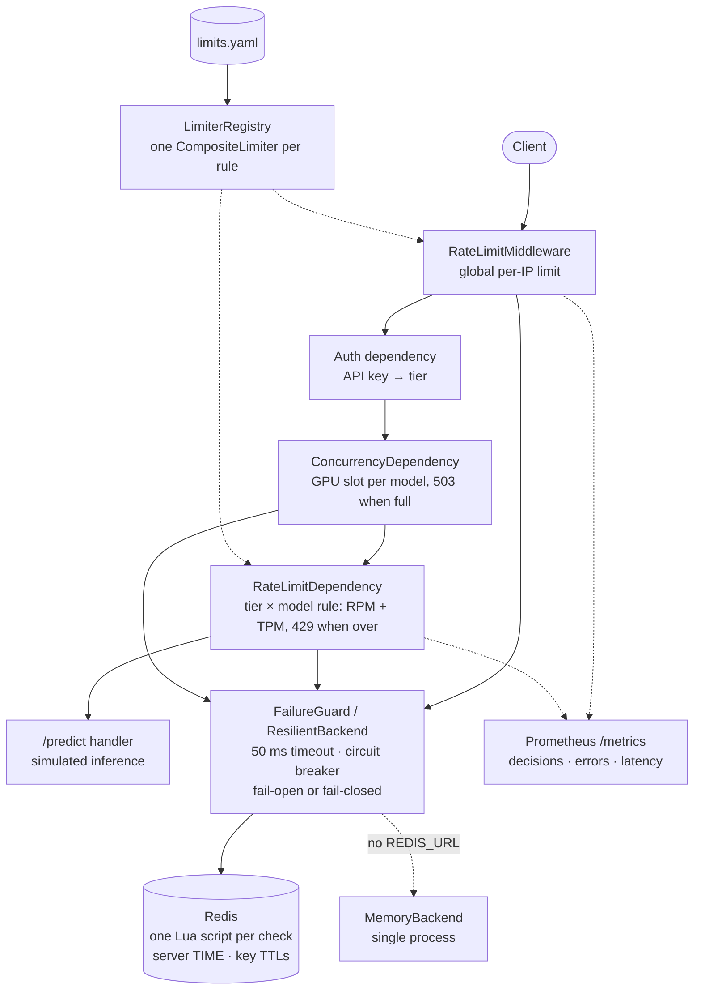

# mlratelimit

Async rate limiting for ML and LLM inference APIs. It has five algorithms behind one
`RateLimiter` interface, an in-memory backend and a Redis backend where every check is one
atomic Lua script, and a FastAPI integration with per-tier, per-model and token-cost limits,
GPU concurrency caps, fail-open or fail-closed behaviour on Redis outages, and Prometheus
metrics.

```python
result = await limiter.check("user:42", cost=1_250)  # an LLM call costing ~1,250 tokens
# RateLimitResult(allowed=True, limit=40000, remaining=38750, retry_after=0.0, reset_at=...)
```

**Contents:** [Quickstart](#quickstart) · [Using the library](#using-the-library) ·
[Architecture](#architecture) · [Algorithms compared](#algorithms-compared) ·
[Benchmarks](#benchmarks) · [Design decisions](#design-decisions-and-tradeoffs) ·
[Testing](#testing) · [Configuration](#configuration) ·
[Limitations](#known-limitations-and-next-steps)

## Quickstart

Requires Docker. This starts Redis and the demo API on `localhost:8000`:

```bash
docker compose up --build        # or: make up   (detached, waits until healthy)
```

The demo's free tier allows 5 requests per minute, so the sixth call is rejected:

```bash
for i in 1 2 3 4 5 6; do
  curl -s -o /dev/null -w "%{http_code}\n" -X POST localhost:8000/predict \
    -H 'X-API-Key: demo-free-key' -H 'Content-Type: application/json' \
    -d '{"model": "small-model", "prompt": "Hello!", "max_tokens": 32}'
done
# 200 200 200 200 200 429   (one per line)
```

A rejected call carries the standard headers (output trimmed to the relevant lines):

```console
$ curl -si -X POST localhost:8000/predict -H 'X-API-Key: demo-free-key' \
    -H 'Content-Type: application/json' \
    -d '{"model": "small-model", "prompt": "Hello!", "max_tokens": 32}'
HTTP/1.1 429 Too Many Requests
ratelimit-limit: 5
ratelimit-remaining: 0
ratelimit-reset: 70
retry-after: 22
content-type: application/json

{"detail":"rate limit exceeded"}
```

The exact `reset` and `retry-after` seconds depend on where in the minute you are.
`make smoke` runs the same sequence and fails unless it sees five 200s, then a 429, then the
blocked decision in `/metrics`. CI runs it on every push.

Other things to try:

```bash
curl -s localhost:8000/healthz       # {"status":"ok","backend":"redis","redis":"up"}
curl -s localhost:8000/metrics | grep ^ratelimit_decisions_total
docker compose stop redis            # Redis outage: /predict keeps answering (fail-open),
curl -s localhost:8000/healthz       # {"status":"degraded","backend":"redis","redis":"down"}
docker compose start redis
```

Without Docker: `make install` then `make run` (in-memory backend), or
`REDIS_URL=redis://localhost:6379/0 make run`.

## Using the library

```python
from redis.asyncio import Redis

from mlratelimit import CompositeLimiter, NamedQuota, Quota, RedisBackend, SlidingCounter, Unit
from mlratelimit.resilience import FailureMode, ResilientBackend

redis = Redis.from_url("redis://localhost:6379/0", socket_timeout=0.05)
backend = ResilientBackend(RedisBackend(redis), mode=FailureMode.OPEN)
limiter = CompositeLimiter(
    SlidingCounter(),
    [
        NamedQuota("rpm", Quota(limit=60, period=60)),  # 60 requests/min
        NamedQuota("tpm", Quota(limit=40_000, period=60), Unit.TOKENS),  # 40k tokens/min
    ],
    backend,
    name="pro:llama-70b",
)
result = await limiter.check("user:42", cost=1_250)  # prompt tokens + max_tokens
```

For a single quota, use `Limiter(TokenBucket(), Quota(100, 60), backend)`. Any object with
`async check(key, cost=1) -> RateLimitResult` satisfies the `RateLimiter` protocol, so the
FastAPI pieces (`RateLimitMiddleware`, `RateLimitDependency`, `ConcurrencyDependency` in
`mlratelimit.fastapi`) work with all of them. [`demo/app.py`](demo/app.py) shows everything
wired together.

## Architecture



The core is small. An **algorithm** is a pure function `(state, now, quota, cost) -> decision`
with no storage of its own. A **backend** stores state and applies a batch of checks
atomically and all-or-nothing. Each algorithm exists twice: in Python for the memory backend,
and as a Lua script that mirrors it operation for operation for Redis. A hypothesis test runs
both side by side and requires identical results. Everything else (composite quotas, failure
handling, metrics, HTTP) wraps that core without touching it.

| Module | Responsibility |
| --- | --- |
| `algorithms/` | `FixedWindow`, `SlidingLog`, `SlidingCounter`, `TokenBucket`, `LeakyBucket` |
| `backends/` | `MemoryBackend`, `RedisBackend` plus `lua/` scripts |
| `limiter.py`, `composite.py` | `Limiter` (one quota), `CompositeLimiter` (RPM + TPM together) |
| `resilience.py` | `CircuitBreaker`, `FailureGuard`, `ResilientBackend` |
| `concurrency.py` | in-flight caps: memory, and Redis leases that expire |
| `config.py`, `registry.py` | YAML limits (tiers × models) → cached limiters |
| `keys.py` | client IP (trusted proxies only), hashed API key, user id |
| `metrics.py`, `log.py` | Prometheus metrics, JSON log formatter |
| `fastapi/` | middleware, dependencies, 429 and `RateLimit-*` headers |

## Algorithms compared

The accuracy and memory columns are measured by `make bench` (`bench/accuracy.py`) with a
quota of 100 per 60 s. *Peak / limit* is the most requests admitted inside any 60-second
sliding window, divided by 100, so 1.00 means the limit held in every window. The boundary
burst sends 100 requests at 59.9 s and 100 at 60.0 s. The random-bursts workload is an hour
of seeded bursty traffic (9,763 requests).

| Algorithm | Peak / limit: boundary burst | Peak / limit: random bursts | Admitted vs exact log | Redis bytes per key (after 100 requests) | Burst handling | Time per check | When to use |
| --- | ---: | ---: | ---: | ---: | --- | --- | --- |
| Fixed window | 2.00 | 1.95 | 1.20 | 104 | Up to 2× the limit across a boundary | O(1) | Cheap coarse quotas (daily caps, billing periods) |
| Sliding log | 1.00 | 1.00 | 1.00 | 5,192 | Never exceeds the limit in any window | O(n) in requests per window | Low, strict limits: expensive models, abuse limits |
| Sliding counter | 1.00 | 1.55 | 1.03 | 120 | Smooths boundaries; approximate under bursty traffic | O(1) | High-volume per-user API limits (the demo default) |
| Token bucket | 1.00 | 1.95 | 1.27 | 136 | Allows a burst of `limit`, then the refill rate | O(1) | Bursty clients where the long-run average is what matters |
| Leaky bucket (meter) | 1.00 | 1.95 | 1.27 | 136 | Identical decisions to the token bucket | O(1) | When limits are described as a drain rate |

How to read this:

- **Token and leaky bucket reaching 1.95 is by design, not a bug.** They promise "a burst of
  `limit`, then `limit/period` per second", so a full bucket plus a period of refill lets
  close to 2× through in one window. Choose them when that promise is what you want.
- **The sliding counter's 1.55** comes from its assumption that the previous window's traffic
  was spread evenly. Bursts at the end of a window are under-weighted. It is still the best
  O(1) choice when you need something close to "N per sliding minute".
- **Leaky bucket as a meter is a token bucket upside down** (`level = limit - tokens`). The
  property test `test_leaky_bucket_decides_exactly_like_token_bucket` proves they make
  identical decisions. Both exist because the brief asked for both, and showing they are
  equivalent is part of the point. The *queue* variant, which delays requests rather than
  rejecting them, is not implemented.

## Benchmarks

Command: `make bench` (needs Redis at `REDIS_URL`, default `redis://localhost:6379/15`). It
writes raw JSON and these tables to [`bench/results/`](bench/results).

Method ([`bench/run.py`](bench/run.py)): for each backend and algorithm it warms up, then
times every `check()` call with `perf_counter_ns`. The *1 coroutine* run gives per-call
latency. The *64 coroutines* run shares one event loop and a 64-connection Redis pool, which
is how an async API server uses the limiter. There are 20,000 checks per run, rotating over
1,000 keys with a generous quota (1,000 per second), so this is the common "allowed" path.

Hardware: a cloud VM with 4 vCPUs (Intel Xeon @ 2.10 GHz) and 15.7 GB RAM, running Python
3.12.3 and Redis 7.0.15 on the same machine over loopback, so **network latency is not
included**; add your own round trip to a remote Redis. The VM is shared, and two consecutive
runs differed by up to about 25%, so treat these as orders of magnitude.

| Backend | Algorithm | p50 (µs) | p95 (µs) | p99 (µs) | Throughput, 1 coroutine (checks/s) | Throughput, 64 coroutines (checks/s) |
| --- | --- | ---: | ---: | ---: | ---: | ---: |
| memory | fixed_window | 5.2 | 11.5 | 22.6 | 149,038 | 168,037 |
| memory | sliding_log | 5.1 | 7.7 | 21.0 | 161,252 | 120,225 |
| memory | sliding_counter | 5.9 | 12.6 | 23.5 | 136,565 | 148,178 |
| memory | token_bucket | 4.9 | 7.0 | 13.8 | 180,385 | 167,996 |
| memory | leaky_bucket | 4.8 | 6.8 | 20.1 | 178,039 | 164,489 |
| redis | fixed_window | 145.9 | 224.4 | 416.2 | 6,162 | 7,800 |
| redis | sliding_log | 169.9 | 316.5 | 525.9 | 5,158 | 8,659 |
| redis | sliding_counter | 151.1 | 249.7 | 432.7 | 5,921 | 9,212 |
| redis | token_bucket | 142.4 | 207.5 | 342.9 | 6,404 | 9,727 |
| redis | leaky_bucket | 145.0 | 241.1 | 451.1 | 6,133 | 9,029 |

**The bottleneck is the Python client, not Redis.** The same run records CPU use: during the
64-coroutine Redis runs, the benchmark process used 97% to 100% of one core while Redis used
28% to 51% of one ([`bench/results/latency.md`](bench/results/latency.md)). One Python
process tops out around 8,000 to 10,000 Redis-backed checks per second. To go higher, run more
worker processes; they share limits correctly because Redis is the single source of truth.

## Design decisions and tradeoffs

**Atomicity with Lua.** A rate limit check is read, decide, write. Two app servers doing that
as separate `GET` and `SET` commands can both read "1 left" and both allow.
`test_naive_read_modify_write_overadmits` demonstrates this: 500 concurrent naive checks
admit far more than 50. Redis runs a Lua script as one command with nothing interleaved, so
each check is one script. The same 500-coroutine test admits exactly 50 for all five
algorithms. Scripts are invoked by SHA (`EVALSHA`) and reloaded transparently after
`NOSCRIPT`, which a test triggers with `SCRIPT FLUSH`. `WATCH`/`MULTI` was rejected because
optimistic retries collapse on hot keys.

**Clock skew.** App servers' clocks drift, and two servers 300 ms apart would disagree about
windows and refill. Scripts read Redis's own clock (`TIME`), so all servers share one clock.
The memory backend uses an injected `Clock`. Every algorithm clamps time so a clock stepping
backwards never creates quota. Each algorithm has a test for this, on both backends.

**Fail-open vs fail-closed.** When Redis is unreachable, `ResilientBackend` returns a decision
anyway. *Open* (the default) keeps the API up but unprotected during the outage. *Closed*
protects the GPUs but turns a Redis outage into an API outage. Either way it fails fast: a
50 ms timeout per call, and a circuit breaker that opens after 5 consecutive failures so later
requests skip Redis entirely until a probe succeeds. Outages show up in
`ratelimit_backend_errors_total{reason=...}`.

**Memory growth.** Every algorithm reports when its state stops mattering (`expires_at`), and
a property test proves that deleting state at that moment never changes a decision. Redis
keys get that TTL plus 1 s of padding. The memory backend evicts expired entries in write
order on each check, which costs O(1) amortized with no background task. Memory therefore
holds only callers active within about one period. The exception is the sliding log, which
stores one entry per request in the window (5 KB for 100 entries above).

**Hot keys.** All state for one caller lives under one Redis key, so one very hot caller
lands on one Redis shard and is served by one Redis core. In the benchmark, Redis used about
30% of a core at about 9,000 checks per second, so a single key has headroom, but it cannot
scale past one core. Mitigations, such as a small local pre-check or leasing token batches
to each worker, are listed under next steps and not implemented.

**Redis Cluster hash tags.** Keys look like `rl:{user:42}:pro:llama-70b:tpm:sliding_counter`.
Only the part in `{}` decides the cluster slot, so the RPM and TPM keys for one caller always
share a slot. Redis Cluster requires that for a multi-key script. This has not been run
against a real cluster (see limitations).

**Tokens are charged up front.** The real token count is known only after generation, so the
demo charges `ceil(len(prompt) / 4) + max_tokens` before inference and refunds nothing.
That over-charges short answers but can never under-charge. A rejected request charges no
quota at all, because all quotas in a rule are checked in one all-or-nothing batch.

**429 vs 503.** A 429 means *your* quota is spent, and it comes with `Retry-After` and
`RateLimit-*` headers (IETF draft field names). A 503 means *the server* is at its GPU
concurrency cap. `/predict` takes the GPU slot before charging quota, so a request turned
away at capacity costs the caller nothing (`test_large_model_concurrency_is_capped_at_two`).
If a request's cost exceeds the whole quota, the response is a 429 with no `Retry-After`,
since retrying can never succeed.

**Keys.** `X-Forwarded-For` is ignored unless the TCP peer is a configured trusted proxy, and
then it is read right to left: the right-most address that is not ours is the one our
infrastructure vouches for. API keys are SHA-256 hashed before they become Redis keys or log
fields. Metric labels carry rule names (`free:default`), never caller identities, so the
number of Prometheus series stays bounded.

## Testing

```bash
make check        # ruff, mypy --strict (library, demo, bench), pytest with a 90% coverage gate
make test-unit    # only tests that need no Redis
```

There are 207 tests, and line and branch coverage of the library is 100%. Test categories:

- **Behaviour** (`tests/algorithms/`): boundaries, bursts, refill, window rollover, cost > 1,
  cost > limit, and clocks stepping backwards. Every test runs against **both** backends.
- **Properties** (`tests/property/`, hypothesis): exactness of the sliding log in every
  window, `retry_after` exact to the millisecond, expiry being invisible, fixed window,
  sliding counter and token bucket bounds, and leaky bucket ≡ token bucket. To check the
  tests can actually fail, four injected bugs were each caught.
- **Redis integration** (`tests/integration/`, real Redis): Lua ≡ Python parity under random
  traffic, the 500-coroutine atomicity test and its naive counter-example, script reload,
  server time, TTLs, concurrency leases and their expiry, and outages with the circuit
  breaker.
- **HTTP** (`tests/unit/test_fastapi.py`, `tests/demo/`): 429 and 503 responses, headers,
  exempt paths, auth, token-cost limits, per-model overrides, and fail-open and fail-closed
  against an unreachable Redis.

Redis tests skip when Redis is unreachable locally. CI sets `REQUIRE_REDIS=1`, which turns a
skip into a failure. CI runs three jobs: lint and type check, tests against a Redis 7 service
container, and `docker compose up` plus `scripts/smoke.sh`.

## Configuration

Limits live in YAML ([`demo/limits.yaml`](demo/limits.yaml)), validated by pydantic, and
unknown fields are rejected:

```yaml
limits:
  algorithm: sliding_counter
  global_limit: {name: per_ip, limit: 60, period: 10}       # middleware, every request
  tiers:
    free:
      default:
        - {name: rpm, limit: 5, period: 60}
        - {name: tpm, limit: 2000, period: 60, unit: tokens}
    pro:
      default: [...]
      models:
        large-model:                                         # per-model override
          - {name: rpm, limit: 20, period: 60}
          - {name: tpm, limit: 20000, period: 60, unit: tokens}
  concurrency: {default: 8, models: {large-model: 2}}        # in-flight cap per model
```

Models without an override share their tier's default budget, so callers cannot get fresh
quota by inventing model names. The demo service reads environment variables:

| Variable | Default | Meaning |
| --- | --- | --- |
| `REDIS_URL` | unset (memory backend) | Redis connection URL |
| `FAILURE_MODE` | `open` | `open` or `closed` when Redis is unavailable |
| `REDIS_TIMEOUT_MS` | `50` | per-call timeout for Redis |
| `TRUSTED_PROXIES` | empty | comma-separated IPs or CIDRs allowed to set `X-Forwarded-For` |
| `LIMITS_FILE` | `demo/limits.yaml` | limits file path |
| `LOG_LEVEL` | `INFO` | log level (JSON lines on stderr) |
| `BASE_LATENCY_MS` | `20` | simulated inference overhead per call |

The API keys in `demo/limits.yaml` (`demo-free-key`, `demo-pro-key`) are fake demo values.
A real service would look the tier up in its auth system.

## Known limitations and next steps

Limitations:

- **One Python process tops out around 8,000 to 10,000 Redis checks per second**, bound by
  client CPU (measured above). Scale out with workers.
- **Not tested on Redis Cluster or across a failover.** Keys are hash-tagged for Cluster, but
  CI uses a single Redis. With asynchronous replication, a failover can lose the last few
  writes, which briefly over-admits.
- **Concurrency leases are not renewed.** `lease_ttl` (default 120 s) must exceed the slowest
  request, or a long request stops being counted.
- **No token refund.** The upfront estimate is never reconciled with actual usage.
- **One algorithm per rule.** All quotas in a rule share an algorithm, so the batch stays one
  script call.
- **The memory backend serves one event loop.** It is not thread-safe and not shared across
  processes.
- **Headers follow the widely deployed `RateLimit-Limit/Remaining/Reset` draft fields.** The
  newest IETF draft moves to structured `RateLimit` and `RateLimit-Policy` fields.
- **Uvicorn's own access and startup logs are plain text.** Only application logs are JSON.

Next steps:

1. Refund or charge the difference after generation (`adjust(key, delta)`), using actual
   token usage.
2. Hot-key protection: a local token cache per worker that leases quota from Redis in
   batches.
3. A CI job against Redis Cluster, plus a failover test.
4. HTTP-level load test (for example k6 or Locust) of the demo, in addition to the
   library-level benchmark.
5. Lease renewal (heartbeat) for very long generations.
6. OpenTelemetry traces around backend calls.

## Development

See [CONTRIBUTING.md](CONTRIBUTING.md) for conventions and every command, and [LEARNING.md](LEARNING.md)
for short explanations of the backend concepts used here (atomicity, Lua, clock skew,
circuit breakers, and more), written for ML engineers moving into production
infrastructure.

## License

MIT
